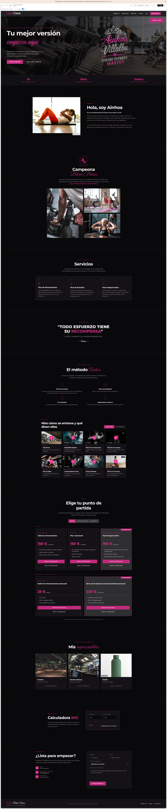
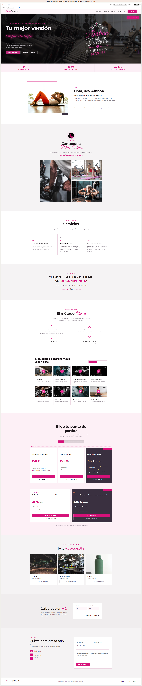

<div align="center">

<br/>

# 🏋️‍♀️ Ainhoa Fitness — Landing Page

**Landing page profesional para entrenadora personal y nutricionista deportiva.**
Zero frameworks. Zero build tools. Solo HTML, CSS y JavaScript puro.

<br/>

[](https://heo-80.github.io/ainhoafitness/)
&nbsp;
[](https://github.com/HEO-80/ainhoafitness)

<br/>


<br/>

| Lighthouse | Score |
|:---:|:---:|
| ⚡ Performance | **97** |
| ♿ Accessibility | **95** |
| ✅ Best Practices | **96** |
| 🔍 SEO | **91** |

<br/>

</div>

---

## 📸 Preview

| Dark mode | Light mode |
|---|---|
|  |  |

---

## 🛠️ Tech Stack

| Tecnología | Versión | Uso |
|---|---|---|
| **HTML5** | — | Estructura semántica (`<section>`, `<article>`, `<nav>`, `<footer>`) |
| **CSS3** | — | Layout, animaciones, sistema de temas con custom properties |
| **JavaScript** | ES6+ | Interactividad, validación, calculadora, navegación |
| **GSAP** | 3.12.5 | Animaciones scroll (fade-in, parallax, stagger, SplitText) |
| **ScrollTrigger** | 3.12.5 | Plugin GSAP — activa animaciones al entrar en viewport |
| **Google Fonts** | — | Bebas Neue · Allura · Montserrat (400–800) |
| **GitHub Pages** | — | Hosting y deploy estático |

> **Sin dependencias locales.** Sin Node, sin bundler, sin transpilador. Clonas, abres `index.html` y funciona.

---

## ✨ Features

### Diseño y UX

- **Single page** — navegación por anclas con scroll suave
- **Dark / Light mode** — toggle con persistencia en `localStorage` + transición suave (0.6s)
- **100% responsive** — mobile-first con breakpoints para tablet y desktop
- **Nav fija con blur** — efecto backdrop-filter al hacer scroll + menú hamburguesa en mobile
- **Hero fullscreen** con imagen de fondo, overlay gradiente y CTAs prominentes
- **Pricing cards** — planes online y presencial con badges "Recomendado" / "Más completo"
- **Tabs accesibles** — secciones de vídeos, tienda y extras con `role="tablist"` + navegación por teclado

### Animaciones GSAP + ScrollTrigger (7 efectos)

| Efecto | Elemento | Detalle |
|---|---|---|
| Fade-in + slide-up | Todas las `<section>` | `opacity: 0→1`, `y: 60→0` |
| Stagger cards | `.af-glow-card` | Cascada con `back.out(1.4)` |
| Parallax hero | Imagen hero | `scrub: 0.5` |
| Scale-in | Fotos de competición | `scale: 0.8→1` |
| SplitText reveal | "Hola, soy Ainhoa" | Letra por letra con `rotateX(-90deg)` |
| Títulos h2 | Encabezados de sección | Fade-in + slide-up individual |
| CTA bounce | Botones de acción | `back.out(2)` |

### Efectos CSS puros

- **Hover glow** en cards — borde fucsia + `box-shadow`
- **Hover logo** — `box-shadow` fucsia + `scale`
- **Drawer slide-in** — `@keyframes drawerIn`
- **Fade genérico** — `@keyframes fadeIn`
- **Transición de tema** — `background-color 0.6s`, `color 0.4s`, `border-color 0.5s`

### Interactividad (vanilla JS)

- **Toggle dark/light** con iconos SVG intercambiables (pesa = light, caballo = dark)
- **Drawer lateral** para vídeos y contenido expandido
- **Calculadora IMC** interactiva con resultado en tiempo real (`aria-live="polite"`)
- **Formulario de contacto** con validación client-side y checkbox de privacidad
- **Tabs** con navegación por teclado en vídeos, tienda y extras
- **Menú hamburguesa** responsive

---

## ♿ Accesibilidad · WCAG 2.1

La página implementa buenas prácticas de accesibilidad web siguiendo las directrices WCAG 2.1:

| Criterio | Implementación |
|---|---|
| **HTML semántico** | `<header>`, `<nav>`, `<main>`, `<section>`, `<article>`, `<footer>` |
| **Jerarquía de encabezados** | H1 → H2 → H3 → H4 en orden secuencial |
| **Atributo `lang`** | `<html lang="es">` declarado en el documento |
| **`aria-label`** | En botón hamburguesa, toggle de tema, botones de vídeo |
| **`aria-live`** | Resultado de la calculadora IMC se anuncia a lectores de pantalla |
| **Tabs accesibles** | `role="tablist"`, `role="tab"`, `role="tabpanel"`, `aria-selected`, `aria-controls` |
| **Alt text** | Todas las imágenes con texto alternativo descriptivo |
| **Imágenes decorativas** | `alt=""` en iconos que no aportan información |
| **`rel="noopener"`** | En todos los enlaces externos (`target="_blank"`) |
| **Contraste** | Paleta diseñada para ratio mínimo AA en texto sobre fondo |
| **`loading="lazy"`** | Carga diferida en imágenes fuera del viewport |
| **Focus visible** | Indicadores de foco para navegación por teclado |
| **`inputmode`** | `decimal` y `numeric` en la calculadora para teclado numérico en móvil |

> **Lighthouse Accessibility: 95/100** — auditoría automatizada sobre la página en producción.

---

## 🎨 Sistema de temas

Dos modos completos gestionados con CSS custom properties:

```css
/* Dark (por defecto) */
--af-bg: #0e0e0e;
--af-ink: #f0ece6;
--af-pink: #d63384;

/* Light */
--af-bg: #faf8f5;
--af-ink: #1a1a1a;
--af-pink: #c2185b;
```

- Toggle con botón fijo (pesa = light, caballo = dark)
- Persistencia en `localStorage`
- Transición suave entre modos: `background-color 0.6s`, `color 0.4s`

---

## 🗂️ Arquitectura

```
ainhoafitness/
├── index.html              # Documento principal (728 líneas)
├── css/
│   └── styles.css          # Estilos completos (1603 líneas)
├── js/
│   ├── main.js             # Lógica: tema, tabs, formulario, IMC, drawer (149 líneas)
│   └── gsap-animations.js  # 7 efectos GSAP + ScrollTrigger (88 líneas)
├── img/
│   ├── af-logo-brillos.png # Logo principal
│   ├── af-horse.png        # Icono caballo (favicon + toggle)
│   ├── ainhoa-*.png/jpeg   # Fotos de Ainhoa
│   ├── rec-*.png           # Productos recomendados
│   ├── Logos/              # Variantes del logo
│   ├── page/               # Screenshots dark/light
│   └── demo/               # Capturas de diseño y referencias
├── GSAP_SCROLLTRIGGER.md   # Documentación técnica de animaciones
└── README.md
```

**Total: ~2.600 líneas de código** · 4 archivos fuente · Sin dependencias locales

---

## 📊 Lighthouse

Auditoría ejecutada con Lighthouse 13.x sobre la página servida en local (imágenes externas de Unsplash excluidas del test de red):

| Categoría | Score | Notas |
|---|:---:|---|
| ⚡ Performance | **97** | Sin frameworks, sin JS bundling, imágenes optimizadas |
| ♿ Accessibility | **95** | ARIA, semántica, alt text, contraste |
| ✅ Best Practices | **96** | HTTPS, `rel="noopener"`, sin errores críticos |
| 🔍 SEO | **91** | Semántica, viewport, `lang`, headings. Pendiente: `<meta description>` |

### Mejoras identificadas

- [ ] Añadir `<meta name="description">` para SEO
- [ ] Revisar contraste en textos secundarios (ratio AA)
- [ ] Corregir salto de heading en sección de vídeos

---

## 🛣️ Roadmap

- [x] Landing page v1 — HTML/CSS/JS puro con GSAP
- [x] Sistema dark/light con persistencia
- [x] Calculadora IMC interactiva
- [x] Accesibilidad WCAG 2.1 (Lighthouse 95)
- [x] Documentación técnica de animaciones GSAP
- [ ] Añadir fotos reales de Ainhoa (sustituir Unsplash)
- [ ] Conectar formulario a Formspree o EmailJS
- [ ] Open Graph tags para preview en redes sociales
- [ ] `prefers-reduced-motion` — respetar preferencia de no-animaciones
- [ ] `prefers-color-scheme` — tema inicial según preferencia del sistema
- [ ] Sección de testimonios con slider
- [ ] v2 — Migración a **Astro** + **Tailwind CSS** con componentes

---

## 🚀 Deploy

### Previsualizar en local

```bash
git clone https://github.com/HEO-80/ainhoafitness.git
cd ainhoafitness
# Abrir index.html en el navegador — no necesita servidor
```

### GitHub Pages

El proyecto está desplegado en GitHub Pages desde la rama `main`:

**Settings → Pages → Source: `main` / `root`**

🌐 **URL:** [heo-80.github.io/ainhoafitness](https://heo-80.github.io/ainhoafitness/)

---

## 📄 Licencia

MIT © [HEO-80](https://github.com/HEO-80)

---

<div align="center">

**Desarrollado por [HEO-80](https://github.com/HEO-80)** · HTML · CSS · JS · GSAP

</div>
